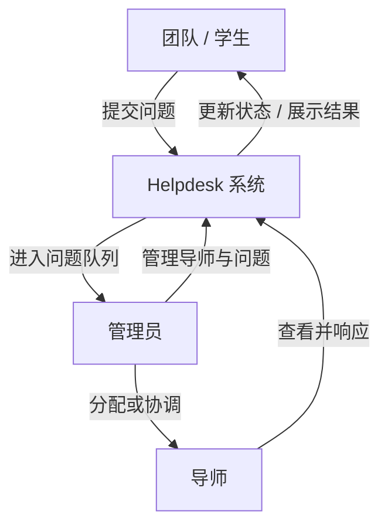

# 03. 远程 GitHub、克隆项目并记录基线

## 预计用时

40-60 分钟。

## 本节位置

本节承接 `02` 的 Git 本地基础。默认前提是：你已经知道 Git 在本地怎么记录版本，也已经知道这门课为什么先做质量基线、为什么 `OpenSpec` 管 change 边界、`Superpowers` 管设计深化和执行纪律。

本节开始把 Git 放到真实世界里：GitHub 作为远程仓库到底解决什么问题，为什么 `clone` 比下载 zip 更适合协作，然后再把真实项目跑起来并记录 baseline。还没有进入 change，也不开始优化。

## 工具使用规则

- 终端负责真实执行：快速确认 `git`、克隆仓库、创建 `.venv`、安装依赖、启动服务、查看目录。
- `Claude Code CLI` 只做只读协作：解释项目地图、帮助整理 baseline 笔记。
- 本节不创建 OpenSpec change，不调用 Superpowers 实现代码，不修改克隆项目里的业务文件。

下面出现的终端命令默认以 **POSIX shell** 为例（macOS / Linux / Git Bash）。如果你在 Windows PowerShell 中操作，先让 `Claude Code CLI` 把 `source`、`find`、`sed` 这类命令换成当前平台的等价写法，再继续本节。

## 学习目标

- 理解 GitHub 作为远程仓库、云端副本和协作中转站的作用。
- 理解 `clone` 和下载 zip 的区别。
- 克隆 `OverClocked Helpdesk` 到 `learn_vibe_adv/overclocked-helpdesk-lab/`。
- 能解释 `origin`、`push`、`pull` 在概念上分别是什么。
- 创建独立虚拟环境并安装依赖。
- 能用角色和问题流转解释这个项目当前在解决什么问题。
- 启动 FastAPI 应用并确认页面或阻塞状态。
- 产出一份 baseline 笔记，作为后续所有 change 的起点。

## 本节产出物

- `learn_vibe_adv/overclocked-helpdesk-lab/`
- `learn_vibe_adv/notes/baseline.md`

## 操作步骤

### 第 0 步：快速确认 Git 已可用

`02` 已经负责 Git 的安装和本地练习。本节只做一个很短的 preflight：

```bash
git --version
```

如果这条命令失败，不要在本节继续安装 Git，直接回到 `02`。

### 第 1 步：先理解为什么这一节开始讲 Remote GitHub

上一节讲的是本地 Git：你电脑上的工作区、暂存区和本地历史。

这一节开始讲远程仓库，也就是 GitHub 这类平台在协作里扮演什么角色。你可以先把 GitHub 理解成三件事：

- 代码的云端副本，避免“只存在一台电脑上”的单点风险；
- 协作中转站，让别人能拿到同一份代码历史；
- 本地 Git 和多人开发之间的连接点。

这里先不用注册自己的 GitHub 仓库，也不用 push 当前课程代码。因为 `OverClocked Helpdesk` 是公开仓库，这一节的目标只是 **从远程拿到代码并看懂它**。

### 第 2 步：理解 clone 和下载 zip 的区别

下载 zip 只会给你当前文件快照。

`git clone` 会给你：

- 当前文件；
- 完整 Git 历史；
- 远程仓库地址；
- 后续 `pull` / `push` 的协作入口。

也就是说，zip 更像“拿一份静态拷贝”，`clone` 更像“拿一份完整仓库副本”。

注意：`02` 里的 `worktree` 是给同一个本地仓库增加另一个工作目录；本节的 `clone` 是从 GitHub 远程仓库拿到一份新的本地仓库副本。

### 第 3 步：在终端克隆项目

在终端执行：

```bash
cd learn_vibe_adv
git clone https://github.com/gagagixi01/OverClocked-Helpdesk.git overclocked-helpdesk-lab
cd overclocked-helpdesk-lab
git status --short
```

预期：`git status --short` 没有输出，说明刚克隆的仓库是干净的。

### 第 4 步：看懂 origin、push、pull，但本节不要求你推送

在终端执行：

```bash
git remote -v
```

克隆完成后，你可以先把这几个词记成概念：

- `origin`：这个仓库默认记住的远程地址昵称；
- `pull`：把远程最新变化拉到本地；
- `push`：把你本地的新提交送到远程。

本节不要求你把课程练习仓库 push 到你自己的 GitHub。当前练习项目是公开仓库，你只需要 clone 下来并在本地分析、运行。

如果你后面真的要和朋友协作，再去配置 GitHub 账号、SSH 或 token 都来得及。这里先知道：**公开仓库 clone 不需要先完成 SSH 配置**。

### 第 5 步：创建环境并安装依赖

在终端执行：

```bash
python -m venv .venv
source .venv/bin/activate
python -m pip install -r requirements.txt
```

如果安装失败，把完整命令和完整报错交给 `Claude Code CLI` 分析。不要只说“安装失败了”。

### 第 6 步：先建立项目的业务模型

`OverClocked Helpdesk` 不是抽象练习，而是一个面向黑客松或校园活动现场的帮助台系统。你在读代码前要先回答：谁提交问题，谁协调问题，谁处理问题。

可以先用这张业务流程图建立 baseline 理解：



后面你在看 `api/`、`models/`、`services/`、`db/` 和 `templates/` 时，不要只记目录名，而要把它们映射回这条业务链路。

### 第 7 步：检查目录结构

在终端执行：

```bash
find . -maxdepth 3 -type f | sort | sed -n '1,120p'
```

重点确认这些路径已经存在：

- `overclocked_helpdesk/api/`
- `overclocked_helpdesk/models/`
- `overclocked_helpdesk/services/`
- `overclocked_helpdesk/db/`
- `templates/`
- `scripts/`

### 第 8 步：启动服务

在终端执行：

```bash
source .venv/bin/activate
uvicorn overclocked_helpdesk.main:app --reload
```

如果启动后终端报错，不要只说“服务启动失败”。像第 5 步处理安装失败一样，把完整启动命令和完整报错交给 `Claude Code CLI` 分析。先让 Claude 只解释原因和给出下一条验证命令，不要直接修改业务代码。

在 `Claude Code CLI` 中输入：

```text
我在启动 OverClocked Helpdesk 时遇到报错。

启动命令：
source .venv/bin/activate
uvicorn overclocked_helpdesk.main:app --reload

完整报错如下：
<paste full terminal output here>

请只做只读分析：
1. 判断这是环境问题、依赖问题、端口占用、数据库/seed 问题，还是项目代码问题；
2. 给我下一条应该在终端运行的验证命令；
3. 不要修改文件，不要创建 OpenSpec change，不要开始修复代码；
4. 如果当前无法启动，请帮我把阻塞原因整理成可以写进 ../notes/baseline.md 的文字。
```

如果 Claude 判断只是端口占用，可以先关闭占用端口的旧服务，或临时换端口启动并在 baseline 里记录实际端口。如果 Claude 判断是依赖或环境问题，先按它给出的验证命令确认原因，再决定是否回到第 5 步重装依赖。只有当启动阻塞被解释清楚并写进 baseline，才继续下一节。

在浏览器打开项目启动后的本地文档页：

```text
http://127.0.0.1:8000/docs
```


### 第 9 步：让 Claude Code 解释项目地图

在 `Claude Code CLI` 中输入：

```text
请只阅读当前 OverClocked Helpdesk 项目，不要修改文件。

工程上下文：
- 我正在做 pre-change baseline assessment，还没有在这个 checkout 里创建任何 OpenSpec change；
- 下一步计划关注 `quality-baseline`，目标是识别现有 mentor assignment 和 query creation 行为的测试覆盖候选点；
- 现在只需要从当前代码里识别候选位置，作为 pre-change baseline observations。

请输出一份项目地图，包含：
1. app 入口在哪里；
2. api、models、services、db、templates 分别负责什么；
3. 团队提交问题、导师查看问题、管理员查看问题的大致数据流；
4. 基于当前代码，`quality-baseline` 最适合补测试的 3 个候选位置，并说明它们对应 mentor assignment、query creation 或启动/回归风险中的哪一类；
5. 不要假设 `openspec/` 或 `docs/superpowers/` 已经存在；
6. 不要写代码，不要创建测试，不要创建 baseline 笔记，不要创建 OpenSpec change；
7. 如果有不确定的地方，请标注“待验证”，不要编造。
```

### 第 10 步：写 baseline 笔记

在 `Claude Code CLI` 中输入：

```text
请根据刚才的项目地图，创建 ../notes/baseline.md。

要求：
1. 只创建或修改 ../notes/baseline.md；
2. 不修改 overclocked_helpdesk/、templates/、scripts/ 下的代码；
3. 包含启动命令、页面入口、关键目录、当前可观察行为、planned `quality-baseline` 测试候选点、已知风险；
4. 明确写清这些测试候选点只是 pre-change baseline observations，不代表已经创建 OpenSpec change 或开始实现；
5. 如果有不确定的地方，请标注“待验证”，不要编造。
```

## 验收标准

在终端运行或检查：

```bash
git --version
cd learn_vibe_adv/overclocked-helpdesk-lab
git remote -v
git status --short
cd ..
cat notes/baseline.md
```

通过标准：

- `git --version` 能成功运行；如果不能，你知道应该回到 `02`。
- 你能解释为什么本节用 `clone`，而不是下载 zip。
- 项目已经被克隆到 `learn_vibe_adv/overclocked-helpdesk-lab/`。
- 你知道 `origin` 是远程仓库地址的昵称，也知道 `push` / `pull` 的概念区别。
- 你能根据流程图讲清谁提交问题、谁协调问题、谁处理问题。
- 项目能启动，或者启动阻塞被清楚记录。
- `learn_vibe_adv/notes/baseline.md` 不只是列目录，也记录了启动命令、页面入口和当前行为。
- 克隆项目里的业务代码没有被修改。

需要停下处理：

- 如果 `Claude` 已经开始改代码，先撤回这一步的越界修改，回到只读 baseline。
- 如果你还不能解释项目当前在做什么，就不要进入 `04`。

## 常见卡点

- 以为“能打开 GitHub 网页”和“本机已经能用 Git clone”是同一件事。
- 以为 zip 和 clone 没区别，结果后面看不到历史，也说不清远程来源。
- 以为本节必须先配置自己的 GitHub 账号或 SSH，其实公开仓库 clone 不需要。
- 直接跳进代码和目录，没有先建立“谁提交问题、谁协调、谁处理”的业务模型。
- 把当前业务目的和 Future Scope 混在一起，以为认证、WebSocket、Analytics 已经是主流程。
- 没有激活 `.venv` 就安装或启动。
- 安装失败时只给 Claude 一句“报错了”。
- baseline 笔记写成感想，没有启动命令和可观察行为。
